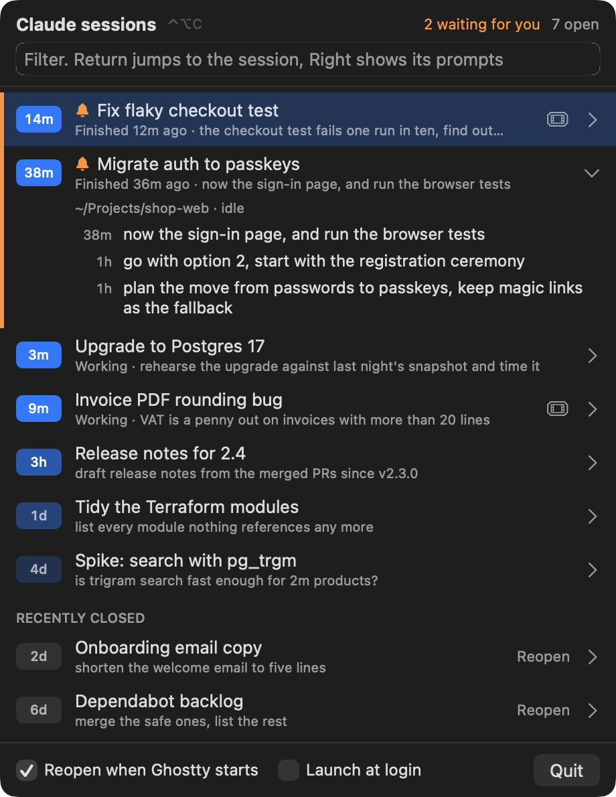

# Lord of the Claudes

One panel to rule them all. A macOS menu bar app that tracks every Claude Code session open in Ghostty, tells you which ones are waiting for you, and brings them all back after a reboot.

  

## What it does

- **Shows every session in one list.** Title, last prompt and time since you last spoke to it.
- **Flags the ones waiting for you.** A session that has finished while its tab was out of sight gets a bell. The menu bar shows the count as "2/7".
- **Jumps to the tab.** Ctrl+Option+C opens the panel from anywhere. Type to filter, Return to jump.
- **Reopens everything after a restart.** Quit Ghostty or reboot, and each session resumes in the tab it was in.
- **Remembers closed sessions.** They stay under "Recently closed" for 14 days with a Reopen button.
- **Links to the ticket.** A Jira key or Zendesk ticket number in the session title becomes a button.

  

## Install

Needs macOS 14 or later, [Ghostty](https://ghostty.org) 1.3 or later and the Xcode command line tools.

    brew install jonesybaker/tap/lord-of-the-claudes
    lord-of-the-claudes

Or from source:

    git clone https://github.com/Jonesybaker/lord-of-the-claudes
    cd lord-of-the-claudes
    ./build.sh install

On first run macOS asks to let it control Ghostty. Allow it.

## Using it

| Key | Does |
| --- | --- |
| Ctrl+Option+C | Open or close the panel |
| Type | Filter by title or directory |
| Up, Down | Move |
| Return | Jump to the session, or reopen a closed one |
| Right, Left, Tab | Show or hide its recent prompts |
| Esc | Close |

- Hover a running session for an X that ends it and closes its tab.
- Sessions untouched for over a week get a "Close them" banner.
- "Reopen when Ghostty starts" off: the panel offers "Reopen all" instead.
- `pkill -USR1 -x LordOfTheClaudes` toggles the panel from a script.

## Ticket links

Links pasted into a session are picked up by themselves. To turn a Jira key or ticket number in a session title into a link, name your sites in `~/Library/Application Support/LordOfTheClaudes/tickets.json`:

    {"zendesk": "https://example.zendesk.com/agent/tickets/", "jira": "https://example.atlassian.net/browse/"}

## How it works

- Every 5 seconds it reads `~/.claude/sessions/*.json`, Claude Code's registry of running processes, and keeps the ones alive under Ghostty.
- Titles come from the session transcript. Prompts come from `~/.claude/history.jsonl`.
- It drives Ghostty through AppleScript. Tabs are matched to sessions by title.
- It only reads Claude's files. Its own state is `~/Library/Application Support/LordOfTheClaudes/state.json`.
- Nothing leaves your Mac. There is no network code.

## Expect breakage

Claude Code's session files are undocumented and can change in any release. Tested with Claude Code 2.1.322, Ghostty 1.3.1 and macOS 26. If a new version breaks it, open an issue.

## Screenshots

The screenshots show made-up sessions. Regenerate them with:

    swift build -c release && .build/release/LordOfTheClaudes --screenshots docs

## Licence

MIT. An independent project, not affiliated with or endorsed by Anthropic. Claude is a trade mark of Anthropic.
