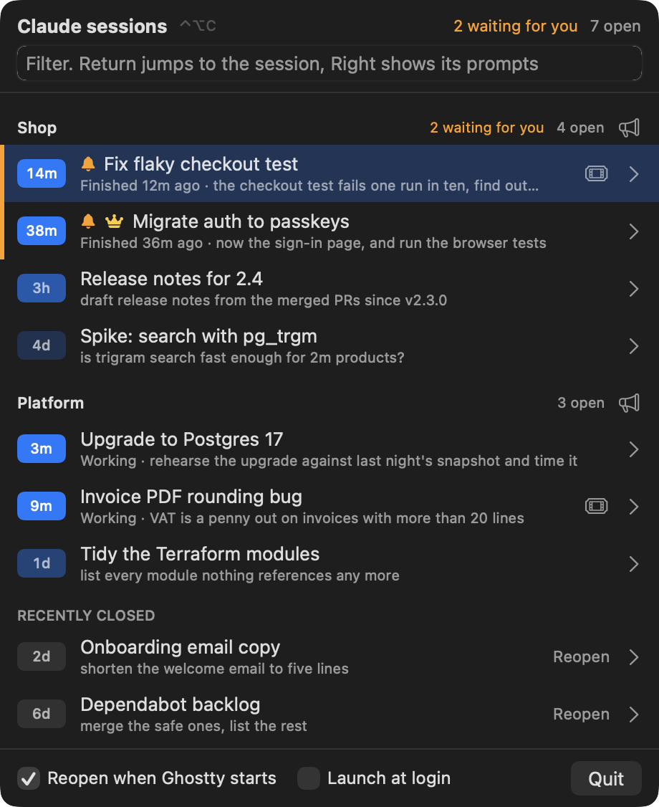
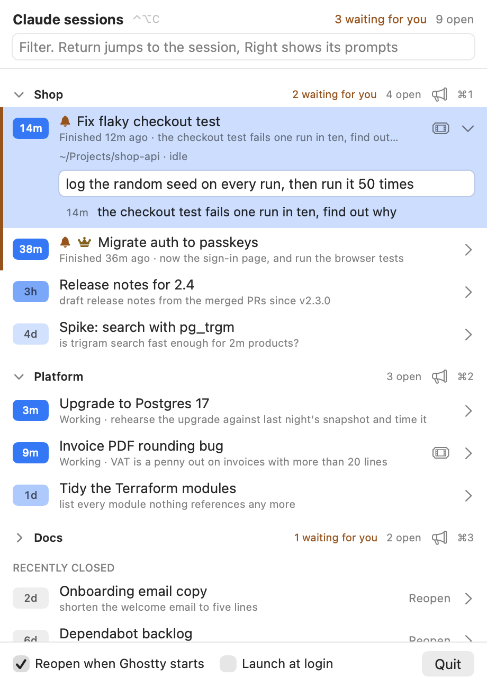

# Lord of the Claudes

One panel to rule them all. A macOS menu bar app that tracks every Claude Code session open in Ghostty, tells you which ones are waiting for you, lets you prompt them and answer their permission prompts in one place, and brings them all back after a reboot.

  

## What it does

- **Shows every session, grouped by Ghostty window.** Title, last prompt and time since you last spoke to it. Each window gets a header with how many are open and how many are waiting.
- **Names your windows.** Click a group's name to rename it. Leave it empty to go back to the directory name.
- **Replies without switching tabs.** Expand a session, type in "Send a prompt" and press Return. Cmd+R opens the field on the selected session.
- **Prompts a whole window at once.** The megaphone on a group sends one prompt to every session in it. It asks once more, naming the count, before it sends.
- **Answers permission prompts in one window.** Approve, deny, or tell Claude what to do instead.
- **Lets one session direct the rest.** A lord session runs `lotc` to prompt its siblings and read their answers.
- **Flags the ones waiting for you.** A session that has finished while its tab was out of sight gets a bell. The menu bar shows the count as "2/7".
- **Jumps to the tab.** Ctrl+Option+C opens the panel from anywhere. Type to filter, Return to jump.
- **Reopens everything after a restart.** Quit Ghostty or reboot, and each session resumes in the tab it was in.
- **Remembers closed sessions.** They stay under "Recently closed" for 14 days with a Reopen button.
- **Links to the ticket.** A Jira key or Zendesk ticket number in the session title becomes a button.

  

## Install

Needs macOS 14 or later, [Ghostty](https://ghostty.org) 1.3 or later and the Xcode command line tools.

    brew install jonesybaker/tap/lord-of-the-claudes
    lord-of-the-claudes

Or from source:

    git clone https://github.com/Jonesybaker/lord-of-the-claudes
    cd lord-of-the-claudes
    ./build.sh install

On first run macOS asks to let it control Ghostty. Allow it.

## Using it

| Key | Does |
| --- | --- |
| Ctrl+Option+C | Open or close the panel |
| Type | Filter by title, directory or group |
| Up, Down | Move |
| Return | Jump to the session, or reopen a closed one |
| Right, Left, Tab | Show or hide its recent prompts |
| Cmd+R | Reply to the selected session |
| Esc | Leave a text field, or close |

- In a reply, broadcast or rename field, the arrows and Return edit the text. Esc leaves the field.
- Right-click a session and choose "Make lord of this group". The lord shows a crown.
- Hover a running session for an X that ends it and closes its tab.
- Sessions untouched for over a week get a "Close them" banner.
- "Reopen when Ghostty starts" off: the panel offers "Reopen all" instead.
- `pkill -USR1 -x LordOfTheClaudes` toggles the panel from a script.

## Answer permission prompts in one place

    lotc hooks install

When Claude Code would ask permission, a window comes to the front. It shows which session is asking, its directory and exactly what it wants to run or change. If several sessions ask at once, it shows them one at a time.

| Key | Does |
| --- | --- |
| Cmd+Return | Approve |
| Cmd+D | Deny. Claude stops, as with "No" in the terminal |
| Type, then Return | Deny and tell Claude what to do instead |
| Esc | Answer in the terminal and go to the tab |

Plain Return never approves: the window takes focus while you may be typing somewhere else. Answer in the terminal and the question leaves the window by itself.

If Lord of the Claudes is not running, Claude Code asks in the terminal as usual. `lotc hooks install` edits `~/.claude/settings.json`, leaves the rest of it as it was and keeps a backup beside it. `lotc hooks uninstall` takes the hook out again.

## Let sessions work together: `lotc`

`lotc` lets a Claude Code session talk to the other sessions in its Ghostty window. Claude runs it through Bash, so one session can be the lord of its window: hand work to its siblings, wait, and read what they said.

| Command | Does |
| --- | --- |
| `lotc list` | The sessions in this window: tab, working or idle, waiting for you, lord, title. `--json` for scripts |
| `lotc send 2 "run the tests"` | Types a prompt into tab 2 and submits it. A tab is its number or part of its title |
| `lotc broadcast "pull main"` | Sends a prompt to every other tab in the window |
| `lotc wait 2` | Waits until tab 2 has finished what it was last sent, then prints its answer |
| `lotc last 2` | Prints tab 2's last answer now |
| `lotc lord` | Makes this session the lord of its window |

`wait` gives up after 110 seconds, inside Claude Code's two-minute Bash limit. Run it again to keep waiting, or pass `--timeout`. A prompt of `-` is read from stdin. Lord of the Claudes must be running.

A lord cannot answer its siblings' permission prompts. Those come to you, in the permission window.

## Ticket links

Links pasted into a session are picked up by themselves. To turn a Jira key or ticket number in a session title into a link, name your sites in `~/Library/Application Support/LordOfTheClaudes/tickets.json`:

    {"zendesk": "https://example.zendesk.com/agent/tickets/", "jira": "https://example.atlassian.net/browse/"}

## How it works

- Every 5 seconds it reads `~/.claude/sessions/*.json`, Claude Code's registry of running processes, and keeps the ones alive under Ghostty.
- Titles come from the session transcript. Prompts come from `~/.claude/history.jsonl`.
- It drives Ghostty through AppleScript. Tabs are matched to sessions by title.
- Replies and broadcasts are typed into the tab through AppleScript, as if you had typed them.
- `lotc` talks to the app over a Unix socket only you can open: `~/Library/Application Support/LordOfTheClaudes/lotc.sock`. It finds its session by walking up its parent processes to one listed in `~/.claude/sessions`.
- It only reads Claude's files, except that `lotc hooks install` adds one hook to `~/.claude/settings.json`. Its own state is `~/Library/Application Support/LordOfTheClaudes/state.json`.
- Nothing leaves your Mac. There is no network code.

## Expect breakage

Claude Code's session files are undocumented and can change in any release. Tested with Claude Code 2.1.322, Ghostty 1.3.1 and macOS 26. If a new version breaks it, open an issue.

## Development

- `./build.sh test` runs the tests.
- `LOTC_WINDOW_TESTS=1 ./build.sh test` also opens the permission window.
- To try `lotc` beside an installed copy, run the build with `LOTC_SANDBOX=1 LOTC_SOCKET=<path>`. That turns off the hotkey and state.json. Set the same `LOTC_SOCKET` for `lotc`.

## Screenshots

The screenshots show made-up sessions. Regenerate them with:

    swift build -c release && .build/release/LordOfTheClaudes --screenshots docs

## Licence

MIT. An independent project, not affiliated with or endorsed by Anthropic. Claude is a trade mark of Anthropic.
