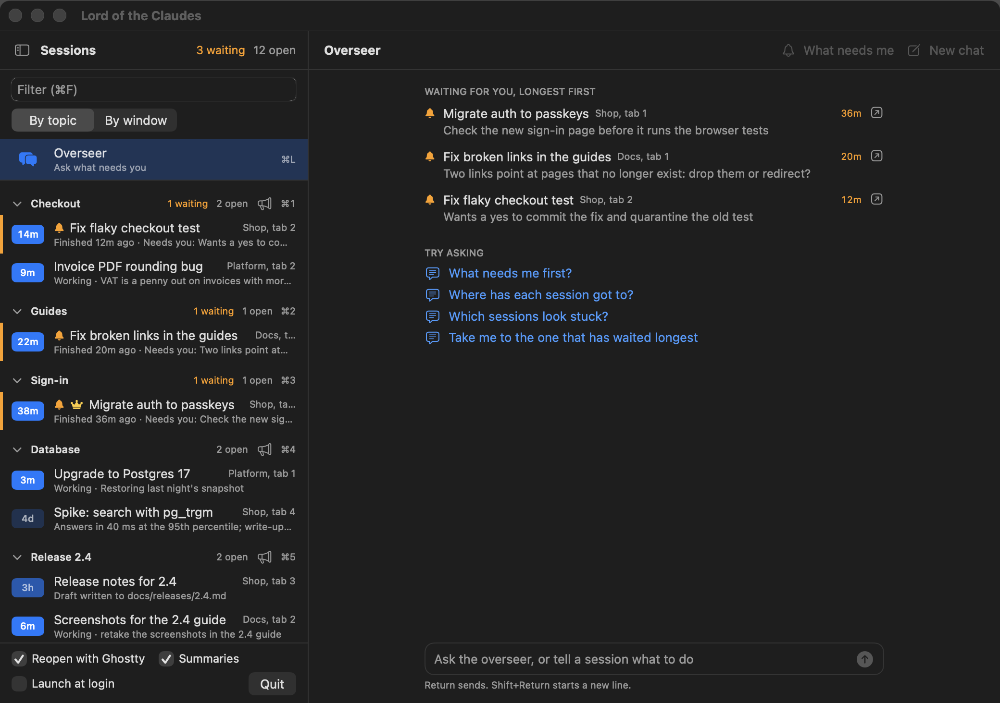
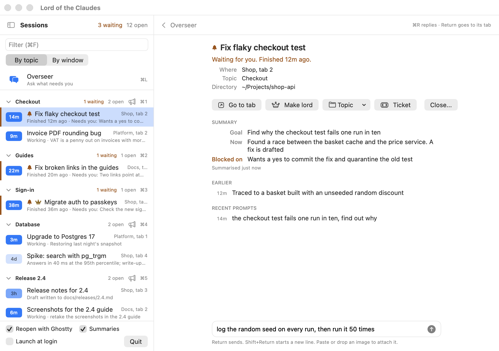
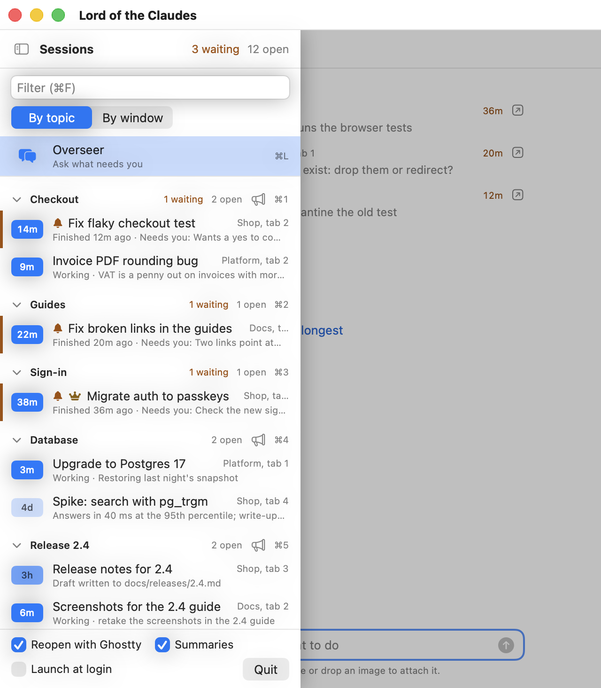
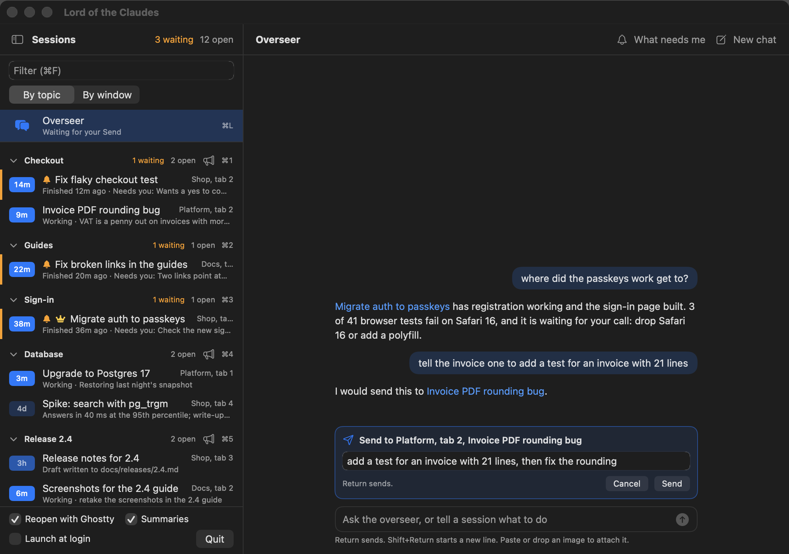
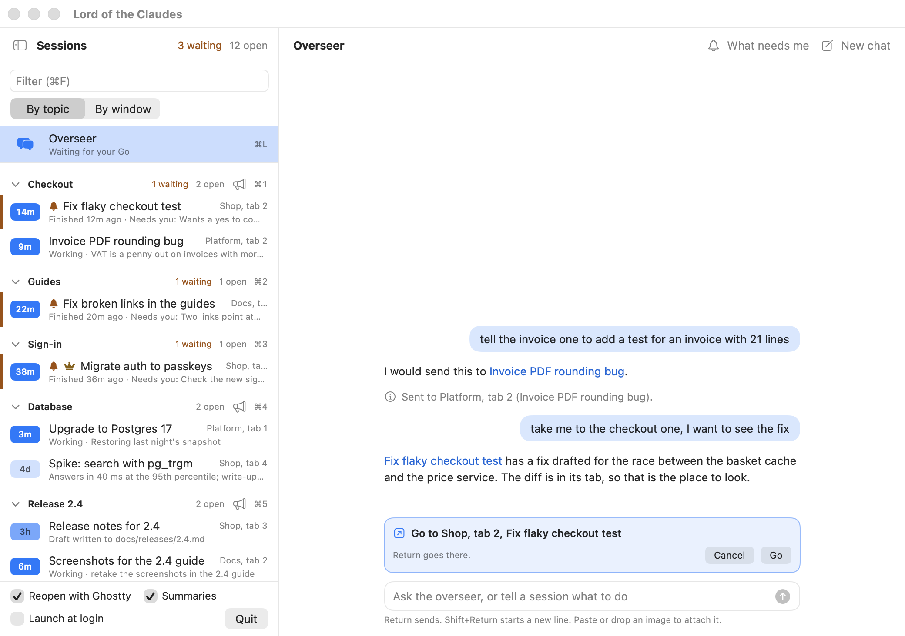
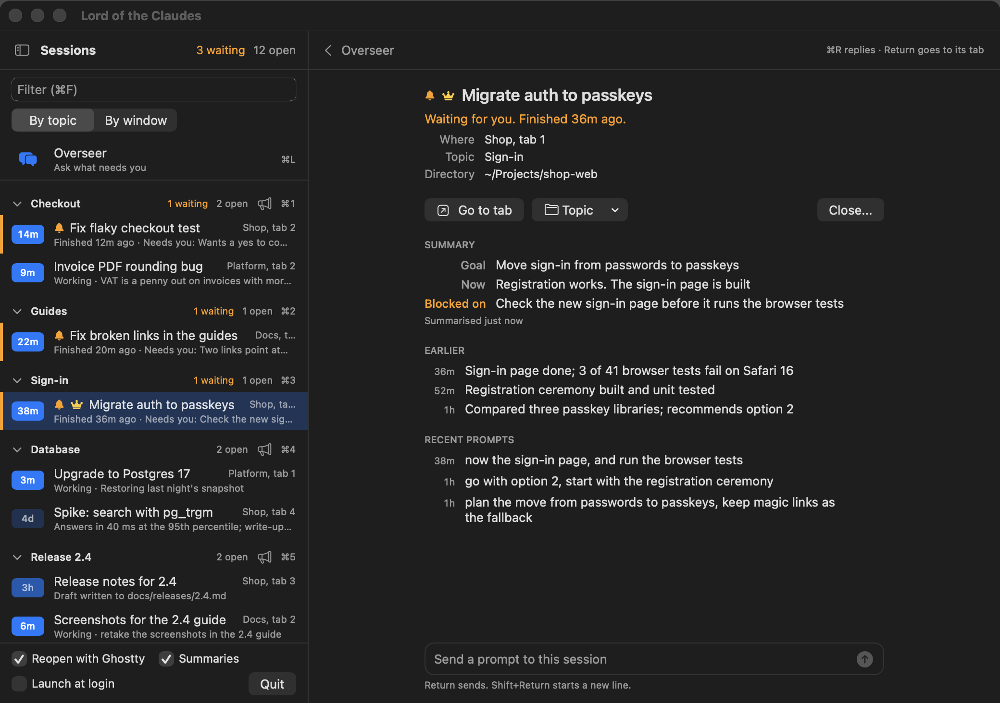
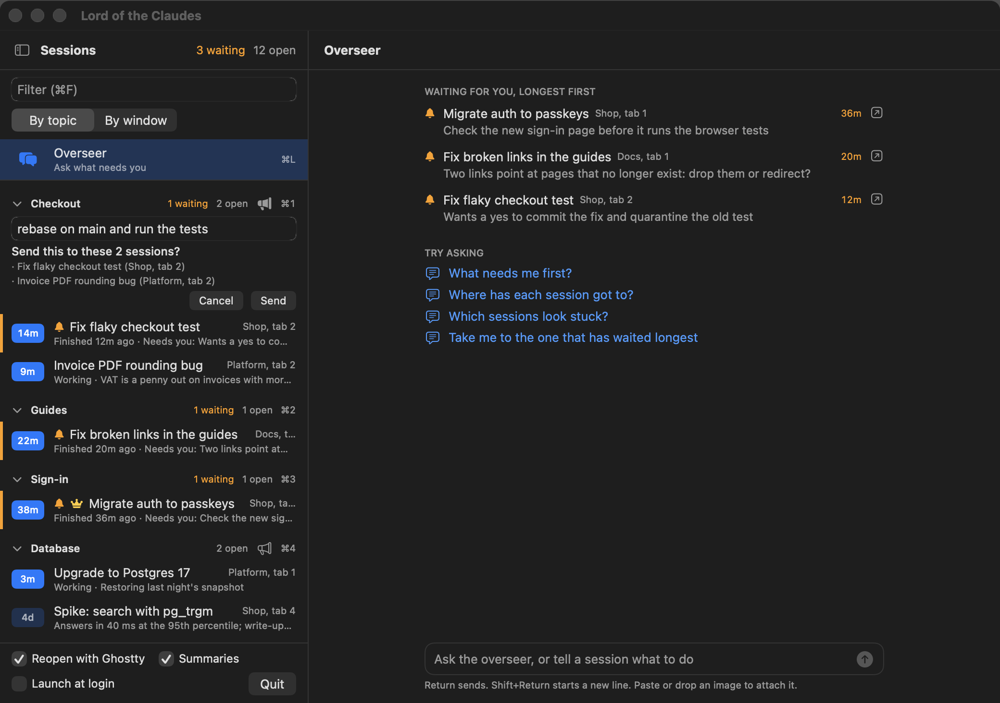
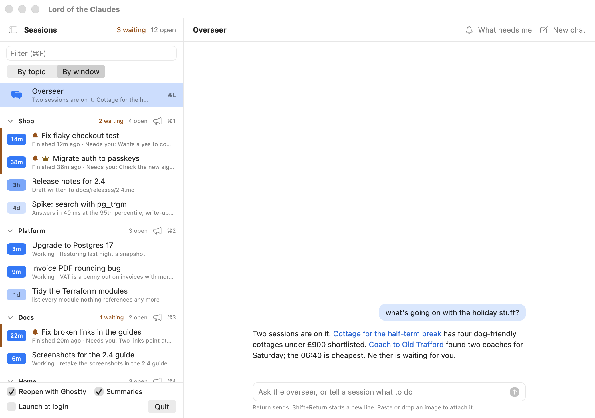

# Lord of the Claudes

One window to rule them all. A macOS app in the menu bar that tracks every Claude Code session open in Ghostty, tells you which ones are waiting for you and what each is doing, lets you prompt them and answer their permission prompts in one place, and brings them all back after a reboot. Its window is a chat with an overseer that answers "what needs me?", puts your prompts in the right tab and takes you to the session you need to see.

  

## What it does

- **Is a proper window.** Resize it, tile it, take it full screen. Ctrl+Option+C or the menu bar icon brings it to the front and hides it again. Closing it leaves the app in the menu bar. While it shows, the app is in the Dock and Cmd+Tab.
- **Has an overseer to talk to.** The main area is a chat with it. Ask where things stand, tell it what a session should do, or ask it to take you to one. See [Ask the overseer](#ask-the-overseer).
- **Lists what needs you.** Every session waiting for you, across all windows, longest wait first, with what each is waiting for.
- **Groups sessions by topic.** The observer files each session under what it is about, "Checkout", "Holiday", "Tax", so a window full of unrelated work sorts itself out. Or group by Ghostty window instead. See [Topics](#topics).
- **Shows a session in full.** Click one in the sidebar for its place, its summary, what it did before and its recent prompts, with Go to tab, Make lord and Close.
- **Folds a group away.** The chevron on a group hides its sessions and keeps its counts. Cmd+1 to Cmd+9 jump to a group, Cmd+Down and Cmd+Up to the next or previous one.
- **Names your groups.** Click a group's name to rename it. A window left empty goes back to its directory name.
- **Replies without switching tabs.** Type in a session's "Send a prompt" box and press Return. Cmd+R takes you there for the selected session.
- **Prompts a group at once.** The megaphone on a group sends one prompt to every session in it. It lists exactly who gets it and asks once more before it sends.
- **Answers permission prompts in one window.** Approve, deny, or tell Claude what to do instead.
- **Sums up each session.** Each time Claude stops, Haiku writes three lines: what the session is for, where it has got to and what it is waiting on you for.
- **Lets one session direct the rest.** A lord session runs `lotc` to prompt its siblings and read their answers.
- **Flags the ones waiting for you.** A session that finishes work while its tab is out of sight gets a bell. Sessions reopened after a restart come back quiet. The menu bar shows the count as "2/7".
- **Jumps to the tab.** Return or a double-click goes to the selected session's tab. Cmd+F filters.
- **Reopens everything after a restart.** Quit Ghostty or reboot, and each session resumes in the tab it was in.
- **Remembers closed sessions.** They stay under "Recently closed" for 14 days with a Reopen button and their last summary. The last five show, the rest behind "Show all". Sessions in a temporary directory are forgotten once closed.
- **Links to the ticket.** A Jira key or Zendesk ticket number in the session title becomes a button.

  

## Install

Needs macOS 14 or later, [Ghostty](https://ghostty.org) 1.3 or later and the Xcode command line tools.

    brew install jonesybaker/tap/lord-of-the-claudes
    lord-of-the-claudes

Or from source:

    git clone https://github.com/Jonesybaker/lord-of-the-claudes
    cd lord-of-the-claudes
    ./build.sh install

On first run macOS asks to let it control Ghostty. Allow it.

## Using it

| Key | Does |
| --- | --- |
| Ctrl+Option+C | Bring the window to the front, or hide it when it is in front |
| Type, then Return | Ask the overseer |
| Shift+Return | A new line in the message |
| Cmd+L | Back to the overseer, with the keyboard in its box |
| Cmd+0 | Show or hide the sidebar |
| Cmd+F | Filter by title, directory, group, topic or summary |
| Up, Down | Move through the sessions |
| Cmd+Down, Cmd+Up | Jump to the next or previous group |
| Cmd+1 to Cmd+9 | Jump to that group. Its number is on its header |
| Right | Show the selected session in the main area |
| Left | Back to the chat, from the list |
| Return, with nothing typed | Go to the selected session's tab, or reopen a closed one |
| Cmd+R | Reply to the selected session |
| Esc | Step back: cancel a proposal, clear the filter, leave a field, go from a session back to the chat |

- The window opens with the keyboard in the overseer's box. With nothing typed, the arrows, Right and Return work the list from there.
- With a proposal waiting and nothing typed, Return acts on it. Type something instead and Return asks that.
- In a reply, broadcast, rename or filter field, Esc leaves the field. A draft stays where it was.
- Typing while the list has the keyboard goes to the overseer's box.
- Esc never closes the window. Cmd+W does, and the app stays in the menu bar.
- Narrower than 760 points, the sidebar folds away and opens over the chat, so the window still works tiled to a third of the screen.
- The window remembers its size and place, the sidebar its width.
- A folded group stays folded until you open it, across restarts. A filter still finds its sessions, and Cmd+N opens it.
- Right-click a session for Go to tab, Move to topic, Make lord of its window and Close. The lord shows a crown.
- Sessions untouched for over a week get a "Close them" banner.
- "Reopen with Ghostty" off: the window offers "Reopen all" instead.
- `pkill -USR1 -x LordOfTheClaudes` shows or hides the window from a script.

  

## Ask the overseer

  

The overseer is a Claude Code conversation the app runs for you. Type in the box at the foot of the window and press Return.

- **It answers.** "What needs me?", "where did the pricing work get to?", "what's going on with the holiday stuff?" It names each session with its group and tab. Click a name to show that session in the main area.
- **It routes, and you confirm.** Tell it what a session should do, "tell the checkout one to rebase", and it puts the exact prompt on a card: "Send to Shop, tab 2". Edit it if you like. Return or Send types it into that tab; Esc or Cancel drops it. Nothing reaches a tab without that confirm.
- **It takes you to a session.** When the answer really is "look at that tab yourself", a diff to review or a question the summary cannot answer, the card says "Go to Shop, tab 2". Return or Go brings that tab to the front. Nothing moves without that press, and most questions are answered without one.
- **It starts new sessions.** When nothing open fits, the card offers a new session instead, in a new tab in the right window, with Claude Code started on your prompt.
- **It asks when unsure.** If two sessions could be meant, the card lists them as buttons.
- **"What needs me" needs no model.** Before you ask anything, and behind the bell button, the chat lists every session waiting for you, longest wait first, with some questions to try. It is worked out in the app.

  

What it sees and what it uses:

- It runs `claude -p` on your own Claude Code login, so it counts towards your plan like any other session. An answer takes a few seconds.
- It sees a short briefing with each message, not transcripts: every open session's group, tab, title, directory, status and digest, or its last prompt when there is no digest. It has no tools, hooks, MCP servers or CLAUDE.md (`--safe-mode`), so it cannot read a file or run anything.
- The chat is kept in `overseer.json` beside `state.json`, up to 60 messages. New chat starts a fresh conversation.
- Claude Code keeps the instructions a conversation started with. When an upgrade changes the overseer's, the next question starts a fresh conversation and hands it the chat's last 20 messages, so you are never left on the old ones.
- To change the model, edit `~/Library/Application Support/LordOfTheClaudes/overseer-settings.json`:

      {"effort": "low", "model": "sonnet"}

  `model` takes any alias or model name Claude Code does, `effort` any of its `--effort` levels. If the app cannot find `claude`, add `"claude": "/path/to/claude"`.

## Answer permission prompts in one place

    lotc hooks install

This adds two hooks to Claude Code: one for permission prompts, and one for the summaries below.

When Claude Code would ask permission, a window comes to the front. It shows which session is asking, its directory and exactly what it wants to run or change. If several sessions ask at once, it shows them one at a time.

| Key | Does |
| --- | --- |
| Cmd+Return | Approve |
| Cmd+D | Deny. Claude stops, as with "No" in the terminal |
| Type, then Return | Deny and tell Claude what to do instead |
| Esc | Answer in the terminal and go to the tab |

Plain Return never approves: the window takes focus while you may be typing somewhere else. Answer in the terminal and the question leaves the window by itself.

If Lord of the Claudes is not running, Claude Code asks in the terminal as usual. `lotc hooks install` edits `~/.claude/settings.json`, leaves the rest of it as it was and keeps a backup beside it. Run it again after an upgrade to add a hook you do not have yet. `lotc hooks status` says which are in, and `lotc hooks uninstall` takes both out again.

## Know what every session is doing

  

Each time Claude stops, Lord of the Claudes reads the end of that session's transcript and asks Haiku for three lines, the goal, where the work has got to and what it is blocked on, and a topic to file it under. A row shows what it is blocked on, else where it has got to. Click it for all three, with the steps before under "Earlier". The filter searches them, so a closed session can be found by what it did.

- **It uses your own Claude Code login.** It runs `claude -p --model haiku`, so each summary counts towards your usage like any other Claude Code run: a few thousand tokens in, a few dozen out. One run per session at a time, two at most at once, and none when the transcript has not changed.
- **What leaves your Mac.** The end of the transcript (its last 40 steps, up to 16,000 characters, with its title, directory and first prompt) goes to Anthropic, exactly as Claude Code itself sends it. The summary comes back and is kept only in the app's state file. The summariser runs with no tools, no hooks, no MCP servers, no CLAUDE.md and no saved session.
- **Turning it off.** Untick "Summaries" at the foot of the sidebar, or `lotc hooks uninstall` to take out both hooks.

## Topics

The sidebar groups sessions by what they are about. Haiku names the topic as it writes each summary, in one to three words: "Checkout", "Holiday", "Tax". It is shown the topics already in use and told to reuse one when the session fits, so the groups stay put.

- **Before any summary,** a session is filed under its project folder, so grouping works from the first day.
- **One odd summary moves nothing.** A session changes topic only when two summaries running agree on the new one.
- **Your hand wins.** Click a topic's name to rename it for every session in it. Rename it to another topic's name to merge the two. Right-click a session and choose Move to topic to put it somewhere else, or in a new topic. A session you have placed stays there; "Let the observer choose" hands it back.
- **Waiting first.** Topics with a session waiting for you come first, then the most recently prompted. Each row says which window and tab it is in.
- **By window** in the sidebar groups by Ghostty window as before. Lords and `lotc` always work by window.
- The megaphone on a topic sends to the sessions in that topic, wherever they are, after listing them.

  

  

- **Needs `claude`.** It looks on your PATH, where the installers put it, and on your login shell's PATH.

## Let sessions work together: `lotc`

`lotc` lets a Claude Code session talk to the other sessions in its Ghostty window. Claude runs it through Bash, so one session can be the lord of its window: hand work to its siblings, wait, and read what they said.

| Command | Does |
| --- | --- |
| `lotc list` | The sessions in this window: tab, working or idle, waiting for you, lord, title, and what each is doing. `--json` for scripts, with each summary in full |
| `lotc send 2 "run the tests"` | Types a prompt into tab 2 and submits it. A tab is its number or part of its title |
| `lotc broadcast "pull main"` | Sends a prompt to every other tab in the window |
| `lotc wait 2` | Waits until tab 2 has finished what it was last sent, then prints its answer |
| `lotc last 2` | Prints tab 2's last answer now |
| `lotc lord` | Makes this session the lord of its window |
| `lotc digest` | Each session's goal, state and what it is blocked on, as plain text for a model. A tab for one session, `--all` for every window |

`wait` gives up after 110 seconds, inside Claude Code's two-minute Bash limit. Run it again to keep waiting, or pass `--timeout`. A prompt of `-` is read from stdin. Lord of the Claudes must be running.

A lord cannot answer its siblings' permission prompts. Those come to you, in the permission window.

## Ticket links

Links pasted into a session are picked up by themselves. To turn a Jira key or ticket number in a session title into a link, name your sites in `~/Library/Application Support/LordOfTheClaudes/tickets.json`:

    {"zendesk": "https://example.zendesk.com/agent/tickets/", "jira": "https://example.atlassian.net/browse/"}

## How it works

- Every 5 seconds it reads `~/.claude/sessions/*.json`, Claude Code's registry of running processes, and keeps the ones alive under Ghostty.
- Titles come from the session transcript. Prompts come from `~/.claude/history.jsonl`.
- It drives Ghostty through AppleScript. Tabs are matched to sessions by title. A new session's tab reads "Claude Code" until Claude names it, so it is matched by directory instead, when it is the only such session and tab there. It never guesses: a session it cannot place shows under "Other" when grouped by window.
- Replies and broadcasts are typed into the tab through AppleScript, as if you had typed them.
- `lotc` talks to the app over a Unix socket only you can open: `~/Library/Application Support/LordOfTheClaudes/lotc.sock`. It finds its session by walking up its parent processes to one listed in `~/.claude/sessions`.
- It only reads Claude's files, except that `lotc hooks install` adds two hooks to `~/.claude/settings.json`. Its own state, summaries and topics included, is `~/Library/Application Support/LordOfTheClaudes/state.json`, with `overseer.json` and `overseer-settings.json` beside it.
- The overseer's conversation is an ordinary Claude Code session in `~/Library/Application Support/LordOfTheClaudes/overseer`. It is never listed in the sidebar, and runs with `LOTC_OBSERVER=1` so `lotc`'s own hooks leave it alone.
- The app has no network code. The summariser's `claude -p` runs and what you ask the overseer, with the briefing, go to Anthropic through Claude Code. Nothing else leaves your Mac.

## Expect breakage

Claude Code's session files are undocumented and can change in any release. Tested with Claude Code 2.1.326, Ghostty 1.3.1 and macOS 26. The summariser and the overseer need its `--safe-mode`. If a new version breaks it, open an issue.

## Development

- `./build.sh test` runs the tests.
- `LOTC_WINDOW_TESTS=1 ./build.sh test` also opens the permission window.
- To try `lotc` beside an installed copy, run the build with `LOTC_SANDBOX=1 LOTC_SOCKET=<path>`. That turns off the hotkey and state.json, and keeps the overseer's files in a temporary folder. Set the same `LOTC_SOCKET` for `lotc`.
- `.build/debug/LordOfTheClaudes --summarise <transcript.jsonl>` runs the summariser once on a transcript and prints what it wrote.
- `LOTC_SANDBOX=1 .build/debug/LordOfTheClaudes --ask <briefing.txt> "<question>"` asks the overseer once against a briefing in a file, in the shape `lotc digest --all` prints, and shows what it proposes. Nothing is kept.

## Screenshots

The screenshots show made-up sessions. Regenerate them with:

    swift build -c release && .build/release/LordOfTheClaudes --screenshots docs

## Licence

MIT. An independent project, not affiliated with or endorsed by Anthropic. Claude is a trade mark of Anthropic.
